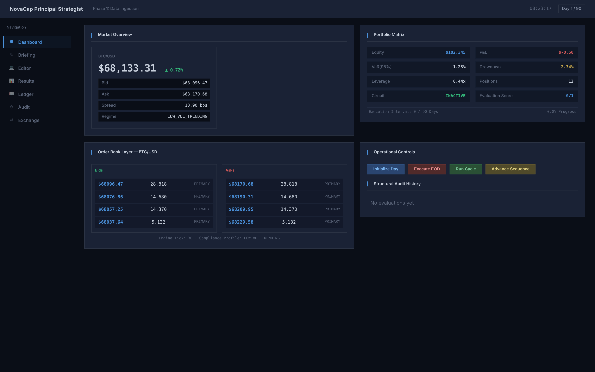
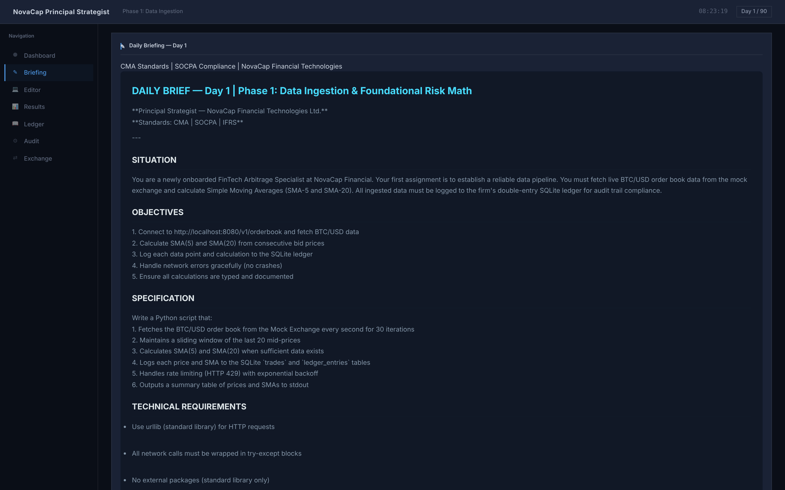
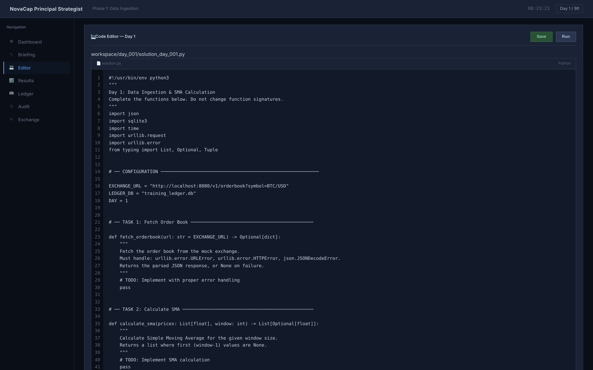
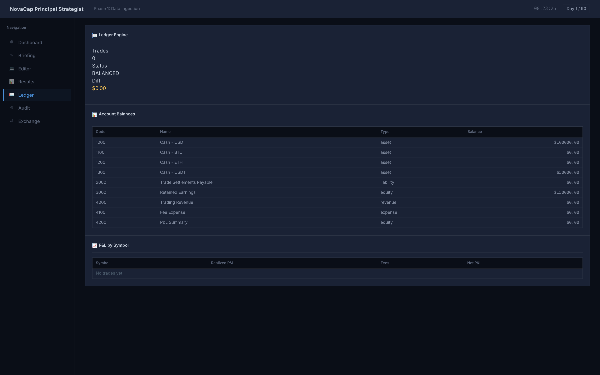
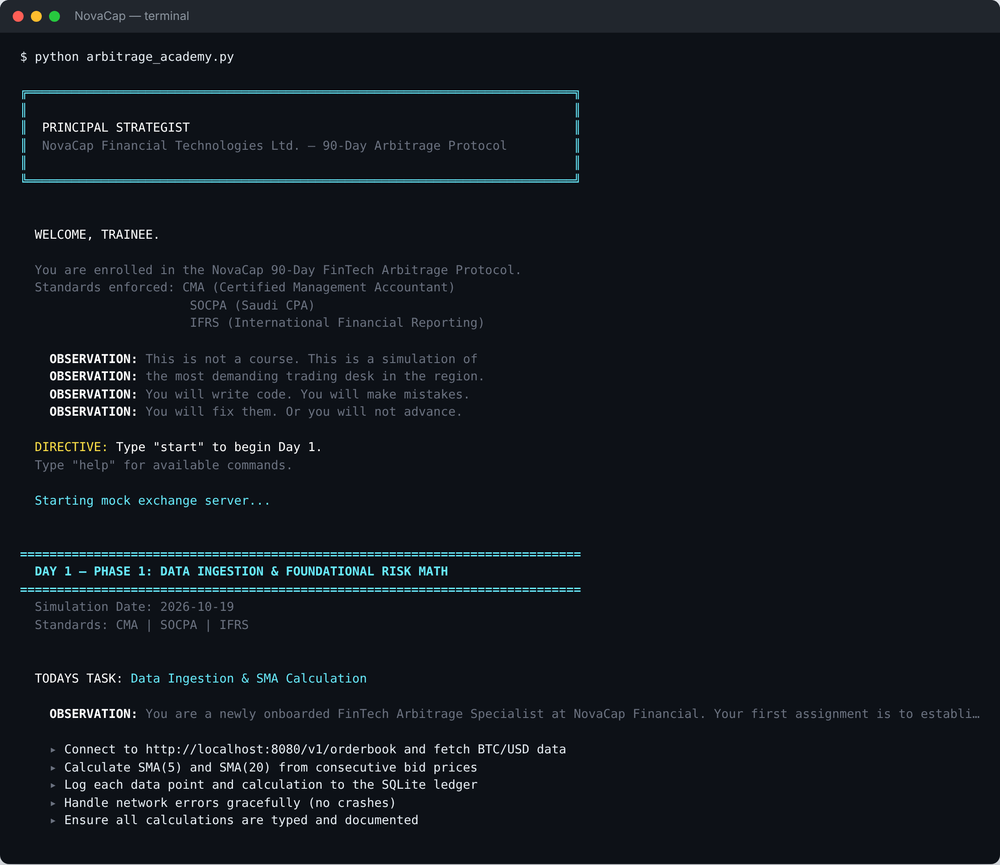
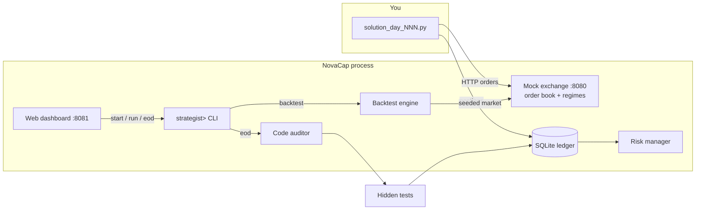

<div align="center">

# NovaCap

**A 90-day algorithmic-trading training simulator in pure Python.**

Write real strategies against a regime-switching mock exchange, keep a double-entry ledger, pass a static code audit and hidden tests each day, and stress your strategy with seeded Monte Carlo backtests, all from the standard library.

[](https://github.com/mutima89/NovaCap/actions/workflows/ci.yml)
[](https://python.org)
[](#quick-start)
[](LICENSE)
[](https://github.com/mutima89/NovaCap/commits)

[Overview](#overview) · [Screenshots](#screenshots) · [Quick start](#quick-start) · [How it works](#how-it-works) · [Commands](#commands) · [Evaluation](#evaluation-pipeline) · [Backtesting](#monte-carlo-backtesting) · [Security](#security-model)



</div>

---

## Overview

NovaCap puts you in the seat of a junior strategist at a fictional fintech firm. Each day brings a brief, a starter Python file, and a deadline: you implement the task, trade against a local mock exchange, and run end-of-day evaluation. Pass, and the next day unlocks.

| Component | What it does |
|---|---|
| **Mock exchange** | HTTP API on `localhost:8080` with seven crypto pairs, a limit order book, market / limit / IOC / FOK orders, fees, slippage and rate limiting |
| **Regime-switching prices** | Alternates between a low-volatility trending regime and a high-volatility mean-reverting regime with jumps |
| **Double-entry ledger** | SQLite chart of accounts; every trade posts balanced debits and credits, checked at end of day |
| **Code auditor** | AST-based static checks for `eval`/`exec`, missing error handling, unbounded loops, missing type hints and more |
| **Hidden tests** | Each day's solution runs against tests you don't see, with a 30-second timeout |
| **Risk manager** | Historical VaR and CVaR, drawdown circuit breaker, position and leverage limits |
| **Monte Carlo backtests** | N seeded markets × D days, scored from the exchange's actual fills |
| **Web dashboard** | Market overview, order book, briefing, in-browser editor, results, ledger and audit views on `localhost:8081` |

The curriculum runs in three 30-day phases: **data ingestion and risk maths**, **arbitrage logic and API execution**, and **slippage, latency and SOCPA-aligned compliance**. Days 1–3 are fully authored briefs with starter code and hidden tests; days 4–90 are generated from per-phase topic templates.

## Screenshots

| Daily briefing | In-browser editor |
|:---:|:---:|
|  |  |
| **Ledger** | **Terminal** |
|  |  |

## Quick start

Requires Python 3.8 or newer. No packages to install.

```bash
git clone https://github.com/mutima89/NovaCap.git
cd NovaCap
python arbitrage_academy.py
```

Then type `start` at the `strategist>` prompt, and open **http://localhost:8081** for the dashboard. Your files live in `workspace/day_NNN/`; edit the solution in your own editor or in the dashboard, then run `eod` to be graded.

## How it works



## Commands

| Command | Purpose |
|---|---|
| `start` | Start the current day: launches the exchange, writes the brief and starter file |
| `run [args]` | Run today's solution |
| `audit` | Static code audit of today's solution |
| `eod` | End-of-day evaluation (audit, hidden tests, ledger check) |
| `advance` | Move to the next day once today is passed |
| `status` · `exchange` · `ledger` · `risk` | Progress, exchange state, ledger summary, risk report |
| `backtest [iterations] [days]` | Monte Carlo backtest of today's solution (default 30 × 30) |
| `risk_reset` | Clear a tripped circuit breaker |
| `reset` | Wipe all progress (asks for confirmation) |

### Mock exchange API

| Method | Endpoint | Purpose |
|---|---|---|
| `GET` | `/v1/health` | Status and uptime |
| `GET` | `/v1/orderbook?symbol=BTC/USD` | Bids, asks, regime |
| `GET` | `/v1/ticker?symbol=ETH/USDT` | Last price and regime |
| `GET` | `/v1/regime` | Current market regime |
| `POST` | `/v1/execute` | Market, limit, IOC or FOK order |
| `GET` | `/v1/orders?status=open` | Open orders |
| `POST` | `/v1/orderbook` | Advance the market one tick |

Symbols: BTC/USD, ETH/USD, BTC/USDT, ETH/USDT, SOL/USD, AVAX/USDT, LINK/USD.

## Evaluation pipeline

`eod` runs three stages in order:

| Stage | Check | Effect on score |
|---|---|---|
| 1. Static audit | `CodeAuditor` over the solution's AST | −40 per critical violation (two or more = 0); −10 per warning |
| 2. Hidden tests | Day-specific tests in a separate process, 30 s timeout | Proportional deduction, up to −60 |
| 3. Ledger integrity | Total debits = total credits (tolerance 0.001) | Imbalance = automatic fail |

## Monte Carlo backtesting

```text
strategist> backtest 30 30
```

For each iteration the exchange quotes from a price generator seeded for that iteration, and your strategy runs once per simulated day. **P&L is computed by the harness from the fills the exchange reports, marked to market at each day's prices** — nothing your script prints affects the score, so trade through `POST /v1/execute`. The same seed always reproduces the same market.

Reported: mean, median, P10/P90 and spread of final equity; mean and median Sharpe; max drawdown (running peak); win rate; and the share of runs with Sharpe above 1.

## Security model

NovaCap executes your Python code, so its local servers are locked down:

- Both servers bind to `127.0.0.1` by default; `NOVACAP_BIND` overrides it (the Docker image uses `0.0.0.0` inside the container).
- Requests must be addressed to `localhost` / `127.0.0.1`, which blocks DNS-rebinding attacks from web pages.
- No cross-origin (CORS) access is granted.
- Every state-changing dashboard request must carry a random per-run token that only the dashboard page receives.

Strategies and tests run as separate processes with your own permissions. That is a crash and timeout boundary, **not a sandbox**; the code auditor is a teaching aid, not a security control. Only run code you have read.

## Docker

```bash
docker build -t novacap .
docker run -it -p 127.0.0.1:8080:8080 -p 127.0.0.1:8081:8081 novacap
```

Publish the ports on `127.0.0.1` as shown so the dashboard is not reachable from other machines.

## Project structure

```text
NovaCap/
├── arbitrage_academy.py   Main simulator: CLI, exchange, ledger, auditor, risk, backtests, dashboard
├── finance_sim.py         Companion corporate-finance daily simulation (CLI)
├── server.py              Web front end for finance_sim.py
├── generate_pdfs.py       Builds the PDFs in docs/ from the Markdown and HTML sources
├── docs/                  Product, training-programme and onboarding PDFs; screenshots
├── TRAINING_PROGRAM.md    Curriculum overview
├── Dockerfile
└── .github/workflows/ci.yml
```

Runtime files (`workspace/`, `save_state.json`, ledger databases) are created in the working directory on first run.

## Continuous integration

GitHub Actions runs 12 checks on Python 3.8, 3.9, 3.10, 3.11 and 3.12: zero-dependency check, AST parse, exchange start-up and health, regime switching, order-book matching, code auditor, ledger double-entry, risk manager, backtest engine, CLI command coverage, a full HTTP integration smoke test, and the Dockerfile.

## Known limitations

- Only days 1–3 have hand-written briefs and hidden tests; later days use generated templates.
- Fills of resting limit orders matched later are not attributed to the order's owner in backtests; market, IOC and FOK fills are.
- The CI workflow runs smoke checks inline rather than a unit-test suite.

## License

MIT — see [LICENSE](LICENSE). All market data is synthetic; nothing here is investment advice.
